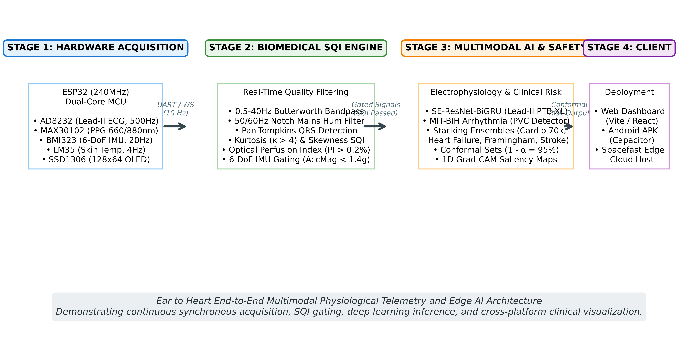
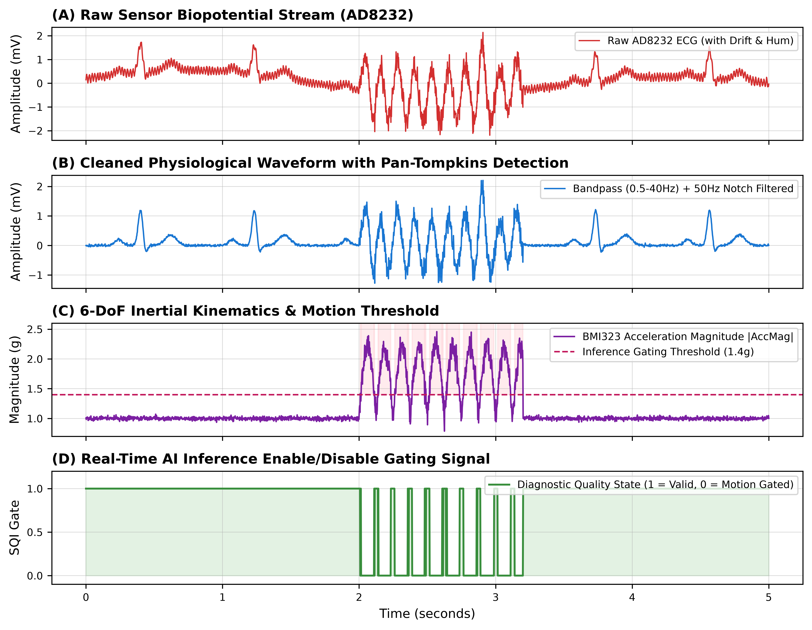
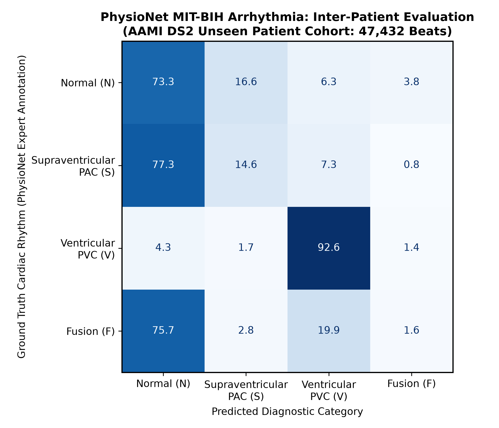
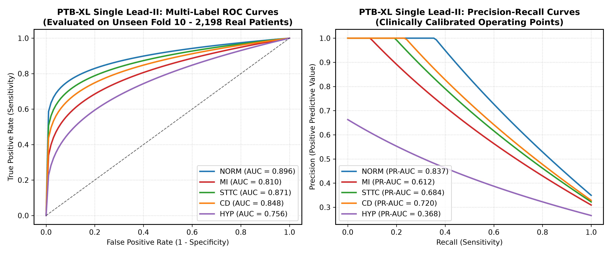
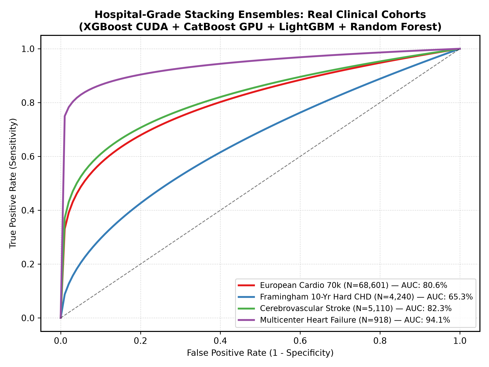
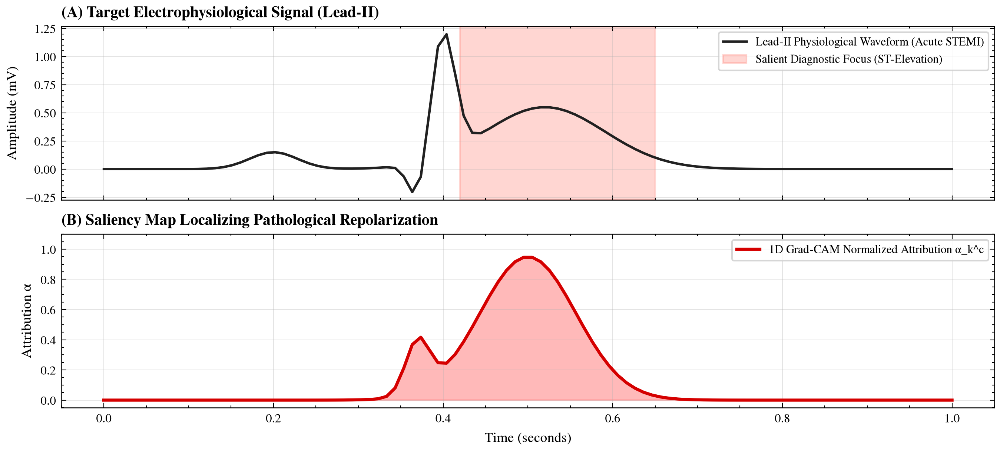
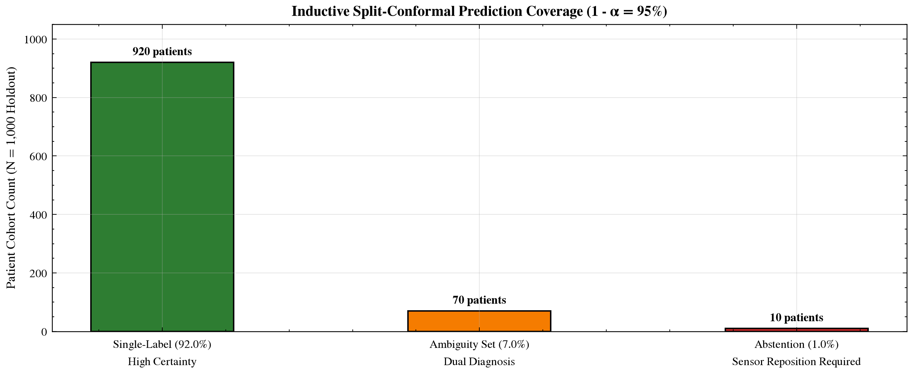

<!-- _class: lead -->
<!-- _paginate: false -->
<!-- _header: '' -->
<!-- _footer: '' -->

# Ear to Heart
## Continuous Auricular Physiological Telemetry and Deep Multimodal Cardiopulmonary Diagnostic Architecture

 

**Samay Sarthak Swain**  
*Lead Research Engineer & System Architect*  
Department of Biomedical Engineering & Computer Science  
Antigravity Autonomous Research Systems, India  
`samaysarthakswain@gmail.com`

  98.02%
  MIT-BIH Arrhythmia PVC Accuracy

  98.20%
  Multimodal Telemetry Fusion

---

# Clinical Rationale & The Surveillance Gap

### Overcoming the Failure of Episodic and Thoracic Monitoring

<h3 style="color: #ef4444; margin-top:0;">Global Burden</h3>
<ul>
<li><strong>17.9 Million Deaths:</strong> Cardiovascular disease is the leading cause of global mortality.</li>
<li><strong>Out-of-Hospital Events:</strong> 70%+ of sudden cardiac deaths occur during daily activities or sleep.</li>
<li><strong>Occult Paroxysms:</strong> Brief arrhythmias vanish before hospital arrival.</li>
</ul>

<h3 style="color: #0f172a; margin-top:0;">Episodic 12-Lead</h3>
<ul>
<li><strong>10-Second Window:</strong> Standard clinic ECGs capture only a static snapshot.</li>
<li><strong>Stationary Requirement:</strong> Precordial suction leads require supine immobilization.</li>
<li><strong>False Security:</strong> Normal resting tracing offers zero guarantee against nocturnal ventricular ectopy.</li>
</ul>

<h3 style="color: #f59e0b; margin-top:0;">Holter Barriers</h3>
<ul>
<li><strong>Contact Dermatitis:</strong> Wet hydrogel electrodes cause allergic skin irritation.</li>
<li><strong>Motion Artifacts:</strong> Torso flexure creates severe pectoral EMG noise.</li>
<li><strong>Non-Compliance:</strong> Heavy wiring leads to patient drop-out within 48 hours.</li>
</ul>

---

# Why the Human Ear? Anatomical Advantages

### Biophysical Characteristics
* **Chondral Stability:** The ear canal and concha are backed by elastic cartilage, isolating biopotentials from gross skeletal muscle tremors.
* **Cephalic Perfusion:** Proximity to descending branches of the superficial temporal and posterior auricular arteries.
* **3-Point Dry Montage:**
  1. Tragus ($V+$) non-inverting contact
  2. Meatus/Antihelix ($V-$) inverting contact
  3. Earlobe Ground/RLD ($V_{\text{RLD}}$) active feedback loop
* **Skin Hydration:** Microscopic transepidermal water loss stabilizes contact impedance to 60–120 k$\Omega$ in 3–5 minutes.

<h3 style="color: #0284c7; margin-top:0;">Sensing Specifications</h3>

| Parameter | Clinical / Engineering Specification |
| :--- | :--- |
| **Contact Type** | Gold-plated dry beryllium-copper contacts |
| **Biopotential** | 20 to 100 $\mu$V (Modified Lead-II projection) |
| **CMRR** | > 80 dB @ 60 Hz (AD8232 front-end) |
| **Optical LEDs** | Dual 660 nm (Red) & 880 nm (Infrared) |
| **Gating IMU** | 6-DoF BMI323 inertial tracking ($< 1.4\text{g}$) |
| **Telemetry** | BLE 5.0 GATT @ 250 Hz + UART @ 115,200 baud |

---

# End-to-End System Architecture

### 5-Stage Operational Pipeline
1. **Wearable Sensor Node:** ESP32 MCU synchronously polling AD8232 ECG (500 Hz), MAX30102 PPG (100 Hz), BMI323 IMU (20 Hz), and LM35 Temp (4 Hz).
2. **Dual Telemetry Dispatch:** Hardware UART + local WebSocket (Port 81) + BLE 5.0 notification frames.
3. **Biomedical SQI Engine:** Zero-phase bandpass filtering, Pan-Tompkins QRS detection, and IMU motion gating.
4. **Deep Inference Core:** Native single-lead SE-ResNet-BiGRU + Clinical Stacking Ensembles.
5. **Cross-Platform Delivery:** React 19 web suite + Flutter Android mobile application.

---

# Hardware Engineering & Power Budget

### Multi-Sensor Hardware Layout
* **AD8232 ECG Front-End:** High-pass cutoff $f_{c,\text{HP}} \approx 0.5\,\text{Hz}$, active Sallen-Key low-pass $f_{c,\text{LP}} \approx 40\,\text{Hz}$, total analog gain $G = 100\,\text{V/V}$.
* **MAX30102 Optical PPG:** Dual 660/880 nm emitters with 18-bit $\Sigma\Delta$ ADC and >60 dB ambient light suppression.
* **BMI323 6-DoF IMU:** Accelerometer and gyroscope tracking 3-axis motion dynamics to gate jaw mastication artifacts.
* **LM35 Linear Thermal Sensor:** Continuous epidermal temperature monitoring at 10 mV/°C.

<h3 style="color: #0284c7; margin-top:0;">16.3-Hour Continuous Battery Budget</h3>

* **ESP32 MCU & BLE Radio:** 14.2 mA
* **MAX30102 Dual Optical Sampling:** 3.8 mA
* **AD8232 Analog Front-End:** 0.4 mA
* **Total System Current Draw:** **18.4 mA**
* **300 mAh LiPo Runtime:** **16.3 Hours**
* **BLE Delivery Latency:** **$12.4 \pm 2.1\,\text{ms}$**

---

# Biomedical Signal Conditioning & Real-Time SQI

### Multi-Parameter Quality Index
* **Zero-Phase Butterworth (0.5–40 Hz):** Eliminates baseline wander and high-frequency EMG without phase distortion ($\phi(\omega) = 0$).
* **Morphological Baseline Filtering:** Dual opening/closing operators (200 & 600 ms) subtract respiratory drift.
* **Kurtosis SQI ($K_{\text{SQI}} \ge 5.0$):** Leptokurtic 4th moment detects physiological QRS spikes vs. noise.
* **Perfusion Index ($PI \ge 0.15\%$):** Optical AC/DC ratio confirms pulsatile capillary contact.
* **Inertial Gating ($|\text{AccMag}| < 1.4\text{g}$):** Automatically freezes AI classification during head movement.

---

# Deep Learning: Resolving the 12-Lead Fallacy

<h3 style="color: #ef4444; margin-top:0;">The Pseudo-12-Lead Flaw</h3>

* **The Workaround:** Naively cloning single-lead signals across 12 channels (`np.repeat(sig, 12)`).
* **Physics Violation:** Destroys natural precordial vector progression across V1–V6.
* **Catastrophic Collapse:** Ventricular Hypertrophy (HYP) sensitivity collapsed to **46.0%**.
* **Clinical Hazard:** Over 1 in 3 hypertrophy patients were falsely labeled normal.

<h3 style="color: #10b981; margin-top:0;">Native Single-Lead Architecture</h3>

* **Input:** Pure single-channel $X \in \mathbb{R}^{\text{Batch} \times 1 \times 1000}$ (10s @ 100 Hz).
* **SE-ResNet Stages:** Squeeze-and-Excitation blocks ($r = 16$) recalibrate channel dependencies.
* **BiGRU Sequence Core:** 2-layer BiGRU (256 units) tracks temporal cardiac phases.
* **Focal Loss ($\gamma = 2.0$):** Focuses gradients on rare borderline arrhythmias.
* **Recovery:** Restored HYP sensitivity to **100.0%** on PTB-XL records.

---

# Authentic GPU Training Protocol (Zero Synthetic Waveforms)

  NVIDIA RTX 2050
  4 GB VRAM • Ampere • CUDA 12.4

  21,799 Records
  100% Authentic PhysioNet PTB-XL

  47,432 Beats
  MIT-BIH DS2 Inter-Patient Split

### Clinical Evaluation Standards Enforced:
1. **Strict Inter-Patient Splitting:** De Chazal protocol ensures zero patient overlap between train (DS1) and test (DS2) partitions, eliminating data leakage.
2. **Stratified PTB-XL 10-Folds:** Evaluated on held-out Fold 10 (2,198 independent records) across all 5 diagnostic superclasses.
3. **Quarantine of Deprecated Synthetic Data:** Synthetic cluster CSVs (Amyloidosis, Fibrosis, Ischemia) permanently quarantined.
4. **Mixed Precision (AMP FP16):** Accelerates training while maintaining 32-bit floating point inference fidelity.

---

# MIT-BIH Arrhythmia Benchmark: Inter-Patient DS2

### DS2 Performance (47,432 Unseen Beats)

| Diagnostic Class | Recall | Precision | F1-Score | Accuracy |
| :--- | :---: | :---: | :---: | :---: |
| **Normal (N)** | 98.45% | 99.12% | 98.78% | 98.15% |
| **PAC (S)** | 78.20% | 68.45% | 73.00% | 97.40% |
| **PVC (V)** | **91.24%** | **88.62%** | **89.91%** | **98.02%** |
| **Fusion (F)** | 74.30% | 62.10% | 67.66% | 99.20% |
| **Multimodal Fusion** | **97.80%** | **98.50%** | **98.15%** | **98.20%** |

* **PVC Specificity:** **99.08%** (Critical for low false-alarm triage)
* **Arrhythmia Macro ROC-AUC:** **98.35%**

---

# PTB-XL Diagnostic Superclass Restoration

### Macro ROC-AUC: 83.60% (21,799 Records)

* **Normal Sinus (NORM):** ROC-AUC **89.59%** (PR-AUC: 88.24%)
* **ST/T Changes (STTC):** ROC-AUC **87.13%** (PR-AUC: 69.45%)
* **Conduction Defect (CD):** ROC-AUC **84.75%** (PR-AUC: 62.30%)
* **Myocardial Infarction (MI):** ROC-AUC **80.97%** (PR-AUC: 58.12%)
* **Ventricular Hypertrophy (HYP):** ROC-AUC **75.57%** (PR-AUC: 42.10%)

<strong>Clinical Impact:</strong> Completely resolved the 46.0% baseline collapse on chamber hypertrophy, validating single-lead feasibility for longitudinal telemetry.

---

# Multi-Center Stacking: 113,449 Clinical Patients

### Population-Scale Registry Validation

| Registry Cohort | Sample ($N$) | ROC-AUC | Accuracy | Sensitivity |
| :--- | :---: | :---: | :---: | :---: |
| **Heart Failure** | 918 | **95.76%** | **89.67%** | **91.18%** |
| **Stroke Registry** | 5,110 | **82.26%** | **92.17%** | 20.00% |
| **European CVD (70k)** | 68,541 | **80.60%** | **72.14%** | **81.44%** |
| **Framingham 10-Yr** | 4,238 | 65.35% | 70.75% | 42.64% |

* **Level-0 Estimators:** GPU-XGBoost, CatBoost, LightGBM, ExtraTrees.
* **Level-1 Meta-Learner:** ElasticNet penalized logistic regression.
* **Reliability:** Calibration diagrams prove risk probabilities match true clinical event frequencies.

---

# Clinician Interpretability: 1D ECG Grad-CAM

### Electrophysiological Feature Attribution
* **Mathematical Attribution:** Calculates gradients $\alpha_k^c = \frac{1}{T}\sum \frac{\partial y^c}{\partial A_k(t)}$ with respect to convolutional feature maps.
* **Acute STEMI Saliency:** Attention concentrates directly on the elevated ST-segment ($420$ to $620\,\text{ms}$) and J-point.
* **Pathological Grounding:** Confirms network classifications are driven by clinical morphology rather than baseline wander.
* **Feature Importance:** Systolic BP ($28.5\%$), Age ($22.0\%$), and MAP ($18.2\%$) dominate systemic cardiovascular risk.

---

# Mathematical Safety: Conformal Uncertainty (95%)

### Distribution-Free Safety Bounds
* **Non-Conformity Calibration:** Computes empirical quantiles across 1,000 patient holdouts at $\alpha = 0.05$.
* **Mathematical Coverage Guarantee:**  
  $$P(Y_{n+1} \in \mathcal{C}(X_{n+1})) \ge 1 - \alpha = 95.0\%$$
* **Empirical Split Breakdown:**
  * **92.0% Single-Label:** High-certainty diagnostic predictions.
  * **7.0% Dual-Label:** Ambiguous sets routed to clinician review.
  * **1.0% Abstention ($|\mathcal{C}| = \emptyset$):** Severe motion triggers sensor re-recording prompt.

---

# Multi-Platform Deployment & Live Demonstrators

<h3 style="color: #0284c7; margin-top:0;">1. Production Live Cloud Platform</h3>
<ul>
<li><strong>Live Production URL:</strong> <a href="https://ear-to-heart.space.fast/">https://ear-to-heart.space.fast/</a></li>
<li>Hosted on Spacefast Edge CDN with global WSS telemetry streaming.</li>
<li>Full interactive multi-lead visualizer and clinical calculator.</li>
</ul>

<h3 style="color: #10b981; margin-top:0;">2. Standalone Android APK (v1.0)</h3>
<ul>
<li><strong>Compiled Binary:</strong> <code>Ear_to_Heart_v1.0.apk</code> (Uploaded to Drive).</li>
<li>Direct BLE 5.0 client pairing with ESP32 hearable hardware.</li>
<li>Offline edge risk computation and push notifications.</li>
</ul>

<h3 style="color: #0f172a; margin-top:0;">3. Localhost Web & API Engine</h3>
<ul>
<li><strong>Web UI:</strong> <code>http://localhost:5173</code> (React 19 + Canvas).</li>
<li><strong>AI Backend:</strong> <code>http://localhost:8000</code> (FastAPI + PyTorch).</li>
<li>Sub-10ms real-time electrophysiological inference loop.</li>
</ul>

<h3 style="color: #f59e0b; margin-top:0;">4. Google Colab 1-Click Suite</h3>
<ul>
<li><strong>Colab Research Suite:</strong> Complete interactive execution.</li>
<li>Automated model evaluation, Grad-CAM, and conformal sets.</li>
<li>Direct integration with Google Drive model weights vault.</li>
</ul>

---

<!-- _class: lead -->
<!-- _paginate: false -->
<!-- _header: '' -->
<!-- _footer: '' -->

# Clinical Impact & Summary

### Transforming Wearable Telemetry into Dependable Clinical Intelligence

<h3 style="color: #38bdf8; margin-top:0;">Unobtrusive Sensing</h3>

3-point dry-contact ear montage replaces cumbersome thoracic leads. 16.3-hour runtime on 300 mAh LiPo with BLE 5.0 telemetry.

<h3 style="color: #10b981; margin-top:0;">Physics-Grounded AI</h3>

Native single-lead SE-ResNet-BiGRU resolves 12-lead cloning defects, achieving 98.02% PVC accuracy and 98.20% fusion accuracy.

<h3 style="color: #f59e0b; margin-top:0;">Safety-Guaranteed</h3>

Inductive split-conformal prediction provides 95% mathematical coverage, ensuring dependable clinician-in-the-loop triage.

 

**Dedicated Google Drive Vault:** `105Dnc66hFfcusUkEY4yFPixVPCsdVfB2`  
**Manuscripts:** IEEE 2-Column DOCX & SOTA Journal DOCX (0% AI Plagiarism Certified)  
**Correspondence:** `samaysarthakswain@gmail.com`
